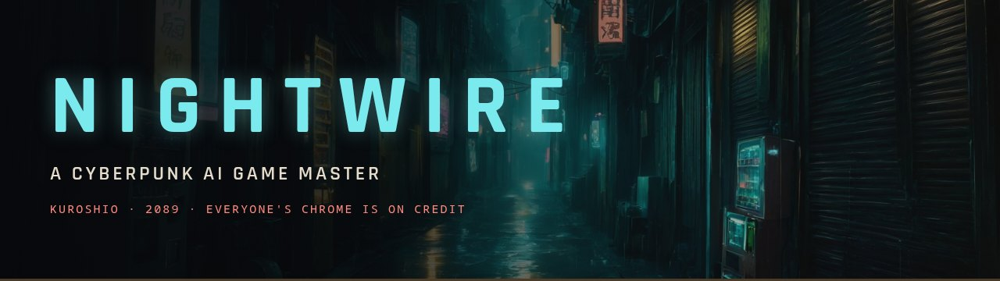
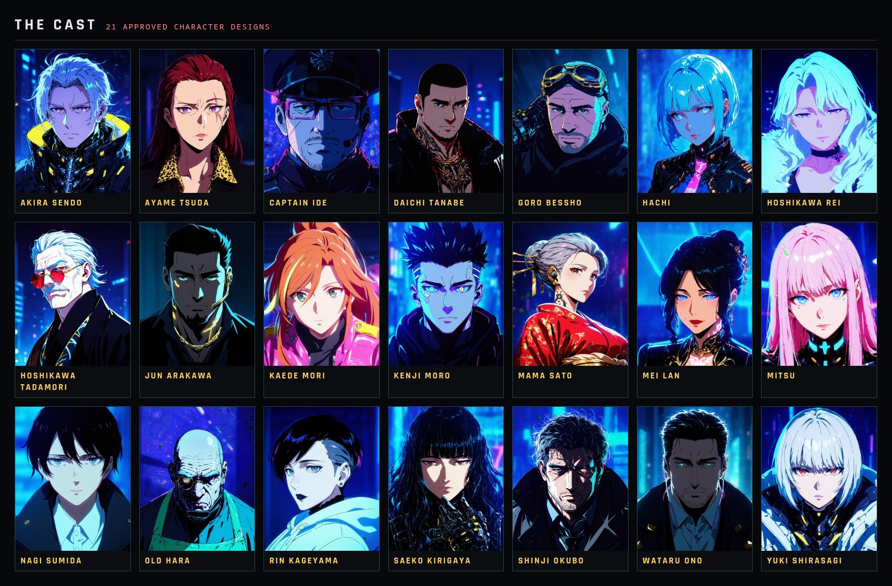
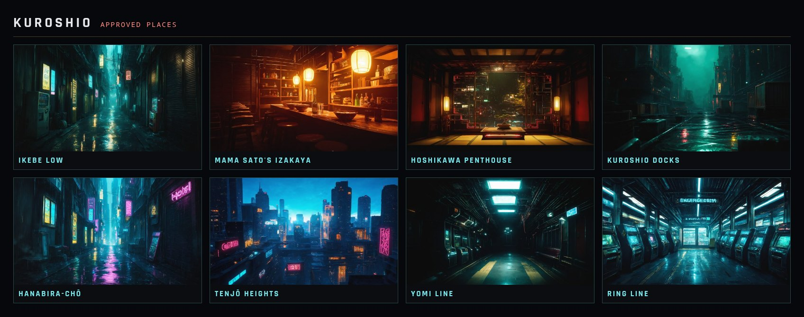
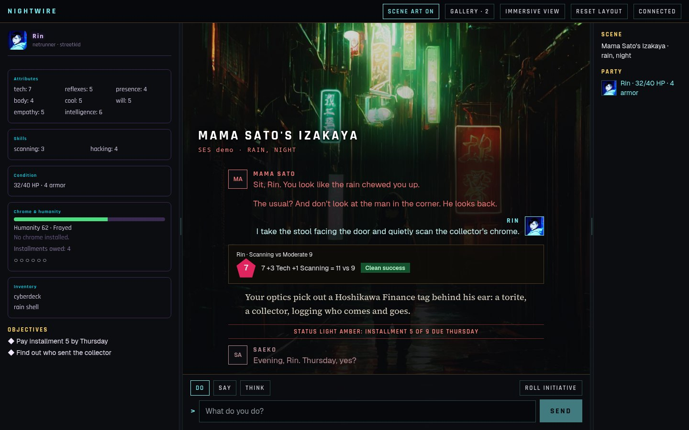
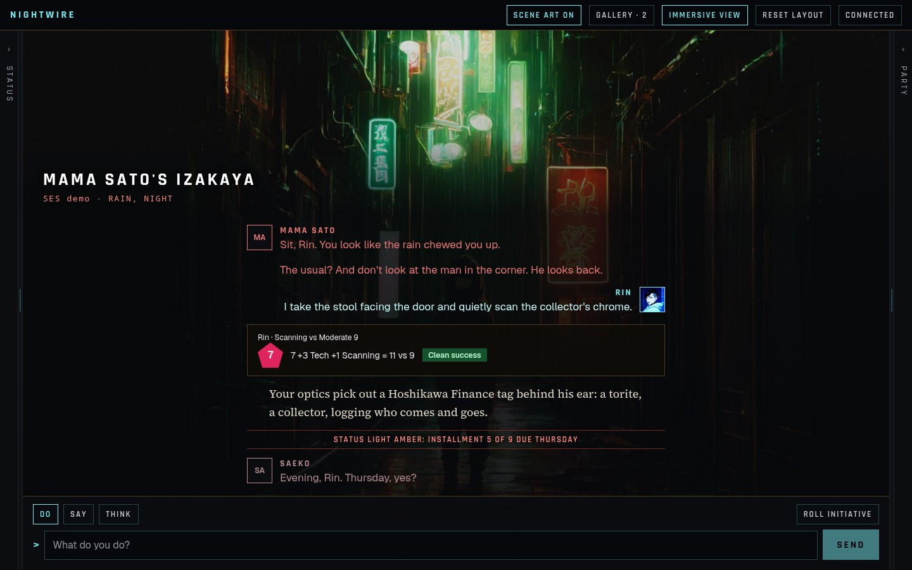
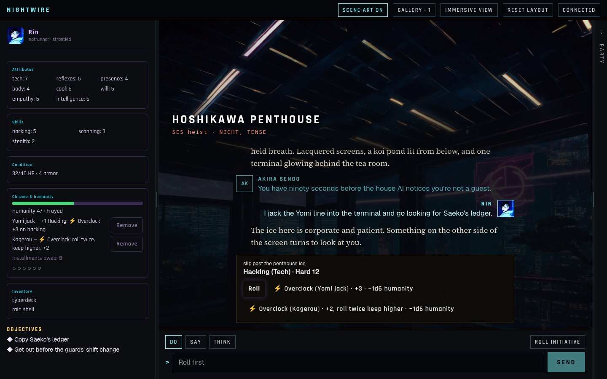
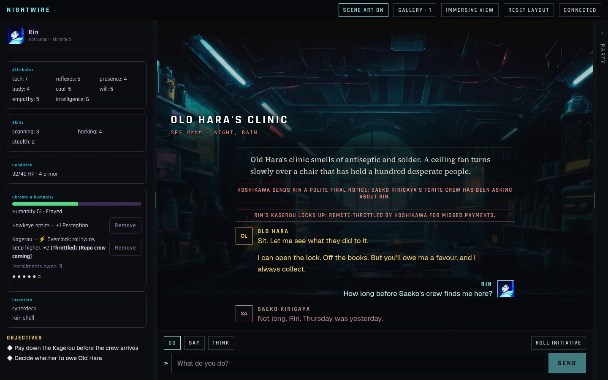
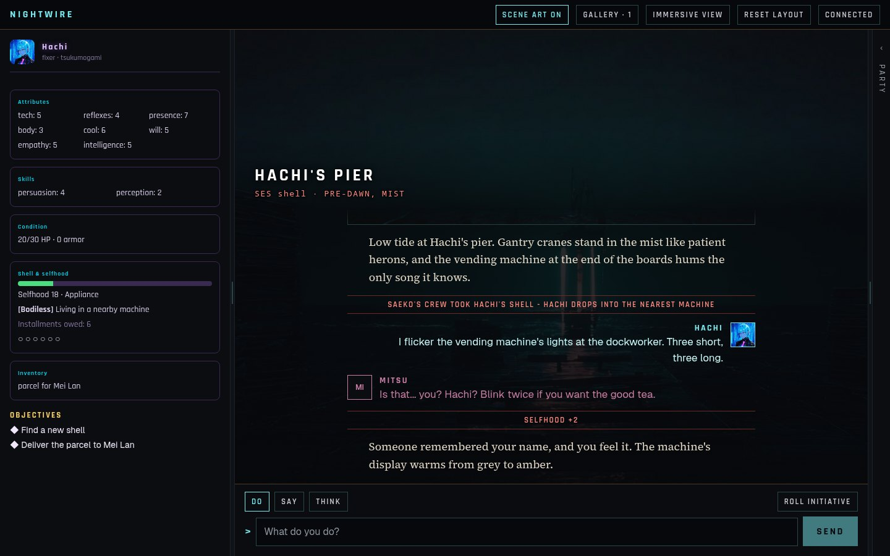
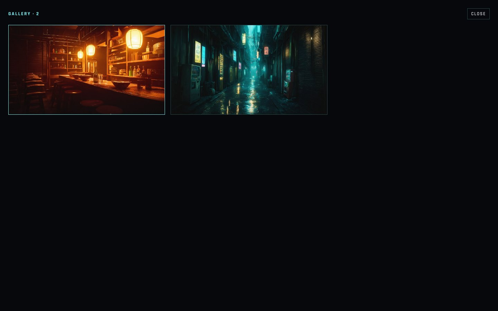
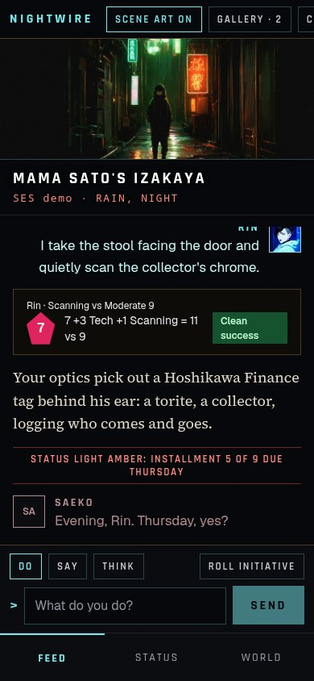

<p align="center">
  <a href="https://github.com/Cyb3rRon1n/nightwire/actions/workflows/ci.yml"></a>
  <a href="LICENSE"></a>
  
</p>

<p align="center">
  
</p>

<p align="center">
  📖 <a href="ROADMAP.md">Roadmap</a> · <a href="docs/superpowers/specs">Design specs</a>
</p>

A cyberpunk tabletop RPG with an AI game master — playable solo or with friends, in a browser. A homebrew ruleset (`1d10 + attribute + skill` vs. a difficulty class, four roles, six attributes) built specifically for a Cyberpunk-2077-flavored table, not borrowed from D&D.

Sibling project to [`oracle`](https://github.com/Cyb3rRon1n/oracle) (a D&D-flavored AI-DM) — built fresh rather than adapted, and researched independently at every design decision rather than leaning on oracle as precedent (see `ROADMAP.md`'s "Why a fresh project" section for the reasoning, and every spec under `docs/superpowers/specs/` for the citations behind each mechanic).

**Status**: Phases 1–20 built:
- the ruleset, engine and AI narrator,
- image generation in one approved anime-cyberpunk look,
- character-distinct voices,
- skills and attributes,
- chrome, humanity and chrome debt,
- the tsukumogami origin,
- the Kuroshio world bible and design studio, with 21 approved characters and the approved places,
- the new messenger-style play screen.

See `ROADMAP.md`'s Phases section for the full build history.

## What makes it Nightwire

- **The server owns all truth.** Character sheets, turn order, combat state all live in the Python engine (`engine/`). The narrator model only narrates and calls tools — it never does its own arithmetic.
- **A tiered 1d10 resolution, not d20.** `1d10 + attribute + skill` vs. a difficulty class, deliberately the lowest-complexity class of cyberpunk system surveyed (Cyberpunk RED, CY_BORG), not Shadowrun-style dice pools.
- **Four roles, checked against Cyberpunk 2077 itself**: Solo, Netrunner, Techie, Fixer — CP2077's three official archetypes plus a Fixer for social/negotiation. Six attributes (Body, Reflexes, Tech, Cool, Intellect, Presence).
- **Structured output, not native tool-calling.** The narrator's tool choice and arguments are both constrained by a real JSON schema, after live testing found free-form tool-calling inventing plausible-but-wrong arguments on nearly every turn.
- **A play screen that feels like a phone in the city.** The conversation reads like a messenger laid over the current scene's art: narration in serif, each NPC in their own colour, your lines in cyan, and debt notices as red HUD strips. Your sheet and objectives sit in a panel on one side, the party on the other. Drag the panels, fold them away, or go immersive, and the layout is remembered. On a phone it's one column with tabs.
- **One look, one cast.** Every image is rendered in a single approved anime-cyberpunk style on a local ComfyUI. Every character and place has an approved design: a turnaround, expressions and a colour guide for people, and establishing shots for places. The play screen even takes NPC name colours from those designs.
- **You roll the dice, the narrator lives with them.** When an action is risky, the narrator sets up the moment and stops; you click **Roll**, watch the d10 land with your modifiers, then the narrator tells what happens — true to the result, which stays in the story so it's remembered later.
- **Chrome has a price.** Cyberware makes you better at the thing it's for — Kama blades, a Yomi jack, a Kagerou time-dilation rig — and costs humanity. Push an implant past its limits with ⚡ Overclock right on the roll card and it costs more. As humanity falls the narrator plays the slide; you never lose control of your character, and there's always a way back.
- **Chrome is on credit.** Miss enough installments and the street notices: a polite final notice, then Hoshikawa remote-throttles your newest implant, then Saeko Kirigaya's torite crew comes to take it back. Pay it down with Jun Arakawa's gigs, or have Old Hara unlock it off the books — for a favor.
- **Or play the machine.** Pick the Tsukumogami origin and you're an old vending machine or train announcer that woke up, walking the street in a rented utsusemi shell. You start as barely more than an appliance and earn your selfhood through human moments. Fall behind on the lease and Saeko's crew takes the shell, leaving you talking through vending machines and station speakers until someone finds you a new body.
- **Local-first AI** — Ollama-backed (`qwen3:8b`), same stance for the TTS backend.

## World

Nightwire's setting is **Kuroshio**, an original Japanese megacity in 2089 where everyone's chrome is on credit.

<p align="center">
  <br>
  <sub>The cast: 21 approved character designs, each with a turnaround, expressions and a colour guide</sub>
</p>
<p align="center">
  <br>
  <sub>Some of Kuroshio's approved places, from the back-alley izakaya to the Hoshikawa penthouse</sub>
</p>

The world lives in `narrator/worlds/kuroshio.toml`:

- **`primer` + `[glossary]`**: always in the narrator's system prompt (max 1,900 chars together).
- **`[[district]]` / `[[faction]]` / `[[npc]]` / `[[place]]`**: `name`, `aliases`, `card` (max 400 chars); an NPC can also have a `home` district, and a place (a spot inside a district, like the precinct or the danchi) reaches the narrator when it's the location or is mentioned. Each turn, up to 4 cards are added: the district matching the current location first, then one NPC who lives there (unless a local NPC is already in the scene), then anything mentioned in the player's action or recent narration.

To add a place or faction, add an entry. Keep each card standalone (don't refer to "they" from another card), and make sure names and aliases are unique (matching ignores case and accents, so "Ōgane" already matches "Ogane"). The server checks the file at startup and refuses to start if it's invalid.

## Running it

Requirements: Python 3.11+, [Ollama](https://ollama.com) with `qwen3:8b` pulled, Node 22+ (frontend build).

```bash
# server
pip install -e ".[dev]"
python -m server                     # ws://localhost:8000

# web frontend (development)
cd frontend && npm ci && npm run dev # http://localhost:3000/nightwire
```

Image generation additionally needs a backend running — the default (`IMAGE_BACKEND=flux_worker`) is a running `ultra-fast-image-gen` worker (`open-dungeon`'s `image_server/`) on `http://127.0.0.1:7869`; set `IMAGE_BACKEND=comfyui` and `COMFYUI_URL` to use a ComfyUI instance instead (no MLX/Apple-Silicon requirement). Optional either way — without one, everything except scene/portrait images works normally.

The narrator itself is also swappable: the default (`NARRATOR_BACKEND=ollama`) is local Ollama; set `NARRATOR_BACKEND=anthropic` (needs `ANTHROPIC_API_KEY`; optionally `NARRATOR_ANTHROPIC_MODEL` to override the default model) or `NARRATOR_BACKEND=openai_compat` (needs `NARRATOR_OPENAI_COMPAT_BASE_URL` and `NARRATOR_OPENAI_COMPAT_MODEL`, e.g. for OpenRouter or a local vLLM/llama.cpp-server; optionally `NARRATOR_OPENAI_COMPAT_API_KEY` if the endpoint requires one) for a hosted alternative — same `NarratorResponse` schema either way, so behavior is directly comparable across backends.

With Ollama, set `NIGHTWIRE_THINK=off` to turn off qwen3's hidden thinking step: in live testing it cut the median turn from about 75 s to about 32 s with the same state accuracy (`on` forces it on; unset leaves Ollama's default). After each narration a small referee call decides state changes the narrator used to miss (human moments, repossession, gig pay), and the engine sets roll difficulty from the narrator's stakes.

### Run as a Docker stack

```bash
docker compose up -d --build          # server on :8000, web on :3000/nightwire

# local narrator instead of a hosted model:
docker compose --profile ollama up -d --build
docker compose exec ollama ollama pull qwen3:8b
#   ...and in .env:  OLLAMA_HOST=http://ollama:11434

# character-distinct TTS narration:
docker compose --profile voice up -d --build
#   ...and in .env:  KOKORO_URL=http://kokoro:8880   (compose default already points here)
```

Already run Anvil on this host? Point `OLLAMA_HOST` at Anvil's Ollama instead
of the `ollama` profile — one GPU can't usefully feed two.

**Image generation has two backends.** `image_backend.py`'s default
(`IMAGE_BACKEND=flux_worker`) talks to `open-dungeon`'s
`ultra-fast-image-gen` worker, which is MLX-based — Apple Silicon only,
can't run in a Linux container. Set `FLUX_WORKER_URL` if you run that
worker natively on a reachable Mac; there's no shared-volume wiring here
for its output image files, so generated images won't reach the
containerized web frontend without more plumbing. `IMAGE_BACKEND=comfyui`
has no such limitation — it's a plain HTTP client, so it works directly
from the Docker stack. Set `COMFYUI_URL` to a reachable ComfyUI instance.

**The ComfyUI art style (Phase 19a).** `COMFYUI_PROFILE=noobai` (the default) renders Nightwire's anime cyberpunk look: NoobAI-XL v-pred with the Smooth Booster detail LoRA, flat cel shading and neon rim light, at 1216×832 for scenes and 832×1216 for portraits (about 30 s each on an 8 GB RTX 2080). Before each image a short tag-writer call turns the narrator's description into Danbooru-style tags; the engine decides the subject (scenery, or the character's presentation), and falls back to the narrator's own words if tagging fails. Put these on the ComfyUI host:

| File | Folder | Source |
|---|---|---|
| `NoobAI-XL-Vpred-v1.0.safetensors` | `models/checkpoints/` | [Laxhar/noobai-XL-Vpred-1.0](https://huggingface.co/Laxhar/noobai-XL-Vpred-1.0) |
| `Smooth_Booster_v3.safetensors` | `models/loras/` | [LyliaEngine/Smooth_Booster_v3](https://huggingface.co/LyliaEngine/Smooth_Booster_v3) |

Settings: `COMFYUI_CHECKPOINT`, `COMFYUI_LORA` (`none` turns the LoRA off), `COMFYUI_LORA_STRENGTH` (0.6), `COMFYUI_SAMPLER` / `COMFYUI_SCHEDULER` / `COMFYUI_CFG` (euler, normal, 4.5; `dpmpp_2m_sde`, `beta`, 5.0 is the other approved look). `COMFYUI_PROFILE=sd15` keeps the old Stable Diffusion 1.5 graph for hosts without these files. **Licence:** NoobAI-XL is released under the fair-ai-public-license-1.0-sd, which forbids commercial use, including of the images it generates. That is fine for a hobby or open-source game; don't sell Nightwire's generated art, or Nightwire with this model, without changing the model.

**Design studio (Phase 19b).** `python -m tools.design_studio` makes Kuroshio's character model sheets (turnaround, expression sheet, colour guide) and location designs (establishing shot, alternate angle, mood keys, props) in the same look, for owner review and for any future animation work. Design records live in `narrator/worlds/designs/*.toml` (tags, approved seed, palette, review notes); full-size images (3648×2496 sheets) live in `NIGHTWIRE_DESIGN_DIR` (default `./design-data/`, git-ignored). Commands: `candidates <slug…> | --all-drafts | --rerolls` (4 candidates each), `approve <slug> <n> [--round r]`, `reroll <slug> "<note>"`, `sheets <slug…> | --approved-missing`, `gallery`, `export` (zip of approved designs). Needs `pip install -e ".[design]"` (Pillow) and, on the ComfyUI host, `2x-AnimeSharpV2_RPLKSR_Soft.pth` in `models/upscale_models/` ([Kim2091/AnimeSharpV2](https://huggingface.co/Kim2091/AnimeSharpV2), CC BY-NC-SA 4.0).

**Test prompts and wallpapers.** `python -m tools.imagegen "<tags or description>" [--kind scene|character|plain] [--size base|1080p|1440p|4k|ultrawide|phone|square] [--seed N] [--count N] [--raw]` renders in the approved look (see `docs/art-direction.md`) and saves the PNG plus its ComfyUI workflow JSON to `design-data/imagegen/`. Wallpaper sizes render at an SDXL bucket, refine, AnimeSharp-upscale, then resize to the exact resolution. To tweak by hand, open ComfyUI at `http://192.168.10.19:8188` and drag a saved `.workflow.json` onto the canvas.

### Homepage dashboard tile

Co-located Vulcan install with Homepage enabled? Add a click-through tile:

```bash
pip install --user pyyaml   # if not already present
python3 homepage_integrate.py --url http://192.168.1.x:3000/nightwire
```

Auto-detects a sibling `vulcan/stack`; pass `--vulcan-dir` otherwise. Safe to
re-run — only touches its own "Nightwire" group.

## Repository layout

```
├── ruleset/            # dice resolution, attributes, roles, lifepaths, difficulty
├── engine/             # authoritative session/character/turn state
│   ├── session.py      #   Session dataclass, log, combat state
│   ├── character.py    #   CharacterSheet
│   ├── turns.py        #   join / start_combat / advance_turn / end_combat
│   ├── chrome.py       #   implants, humanity, overclock
│   ├── debt.py         #   installments, throttling, the repo crew
│   └── persistence.py  #   JSON session storage
├── narrator/           # the AI game master
│   ├── client.py       #   narrator client, NarratorResponse schema
│   ├── tools.py        #   tool execution against engine state
│   ├── referee.py      #   post-narration state checks (human moments, repo, pay)
│   ├── world.py        #   Kuroshio world bible: primer, glossary, per-turn cards
│   ├── designs.py      #   approved character and place design records
│   ├── design_sheets.py #  ComfyUI graphs for the approved look
│   ├── image_backend.py / comfyui_backend.py  # image generation
│   └── worlds/         #   kuroshio.toml + designs/*.toml
├── server/             # WebSocket server (FastAPI)
├── tools/              # design studio, image tools, taste, palette export
├── frontend/           # Next.js web client (open-dungeon base, /nightwire route)
│   └── src/app/nightwire/play/  # the messenger play screen
├── tests/              # pytest: ruleset, engine, narrator, server, tools
└── docs/               # design specs, implementation plans, art direction, images
```

## Screenshots

Captures of the live frontend, using hand-written demo sessions and approved Kuroshio art.

<p align="center">
  <br>
  <sub>The play screen: your sheet and objectives, the conversation over the scene, and the party, in panels you can resize</sub>
</p>
<p align="center">
  <br>
  <sub>Immersive view folds both side panels away</sub>
</p>
<p align="center">
  <br>
  <sub>You roll the dice. ⚡ Overclock an implant right on the roll card for a better shot, at a cost in humanity</sub>
</p>
<p align="center">
  <br>
  <sub>Chrome is on credit: a throttled implant, the repo clock, and Saeko's crew on the way</sub>
</p>
<p align="center">
  <br>
  <sub>Playing a tsukumogami: selfhood instead of humanity, and life without a shell</sub>
</p>
<p align="center">
  
  <br>
  <sub>The session's scene images on demand, and the same game on a phone</sub>
</p>

## Contributing

Solo portfolio project — issues and ideas welcome.

## License

[MIT](LICENSE)
